# Recommender systems course

Hi!
This block of homework assignments is about building a small recommender systems framework. While solving them, you will get to know a mini-framework for building the runtime of a recommender system.

This is the public version of the homeworks; a private version with more tests is used inside YSDA (Yandex School of Data Analysis).

The tasks are grouped into 3 (and one bonus) topical blocks, one per week:
- [Microservice, data and experiments](./tasks/basics_and_services/README.md)
- [Candidate generation and blending](./tasks/candgens/README.md)
- [Logging and ranking](./tasks/ranking/README.md)
- (In development) a bonus block on neural network inference and runtime profiles

Many tasks in this course depend on each other, and until you finish the earlier ones you will not be able to solve the later ones (or it will be very hard and not the intended way). For example, the candidate generators depend on whether you implemented the embedding storage or the feature storage correctly, and training the ranker depends on correctly written logging.

### Project structure
The framework consists of several Python modules, and you will develop different parts of it:
- `engine` — the core of the recommendation runtime: interfaces, candidate generators, ranking, database connectors, etc.
- `engine_builder` — the offline part: data processing, model training and updating the state of the service.
- `engine_server` — a FastAPI service that provides an API for getting recommendations for a user and a context.
- `experiments_server` — a toy service for experiment management: splitting users into groups and parametrization by group.

Some parts are already done for you:
- `engine_downloader` — a sidecar service that downloads the current data snapshot for the microservice from S3 into the shared volume of the service container.
- `viewer` — a web service for viewing and analyzing the recommendations on Yandex Lavka data.


Schematically, the dependencies are connected like this.

```mermaid
flowchart LR
  subgraph Data storages
    Filesystem[(volume<br/>archive.tar.gz + marker)]
    S3[(S3)]
    Qdrant[(Qdrant)]
    Valkey[(Valkey)]
    SQLite[(SQLite)]
  end

  subgraph Services
    EngineDownloader[engine_downloader]
    API[engine_server / API]
    Experiments[experiments_server]
    Viewer[viewer web]
    S3Setup[s3-setup]
  end

  subgraph Offline dataflow
    EngineBuilder[engine_builder]
  end

  S3Setup --> S3
  EngineDownloader --> S3
  EngineDownloader --> Filesystem
  API --> Filesystem
  API --> Qdrant
  API --> Valkey
  API -. optional .-> Experiments
  Experiments --> SQLite
  Viewer --> API
  EngineBuilder --> S3
  EngineBuilder --> Qdrant
  EngineBuilder --> Valkey
```




## Course organization
Each task lives in its own block and task directory (`tasks/<block>/<task>`). Its `README.md` holds the statement and the commands to test it locally, for example:
```bash
(cd engine && uv run pytest tests/unit/cgs/test_top_pop.py)
```

The data for running the whole service (the Yandex Lavka actions and catalog) can be downloaded from [Yandex Disk](https://disk.yandex.ru/d/KvyEFHD-sjHSAg); the tests do not need it.

### Setup

To solve the course tasks you need to do a few things:
* Set up git and clone the repository
* Install Python and the required packages
* Learn to run the tests of a task locally

All of this is described in detail in [`SETUP.md`](./SETUP.md); please **read it carefully** before doing anything.


## About

minirec is an educational recommender systems framework that illustrates the components, architecture, and challenges found in production-grade recommenders.
The repository provides partial implementations and tests for each component, organized across multiple assignments.

## Licensing
- Code is provided under the Apache License 2.0; see [LICENSE](LICENSE).
- Written materials (documentation, tutorials, slides, and other text content) are provided under the Creative Commons Attribution 4.0 International license (CC BY 4.0).

## Attribution
If you use these materials in your own course, blog posts, or public repos, please cite them as follows:

> _Roman Nigmatullin, (2026). minirec._
