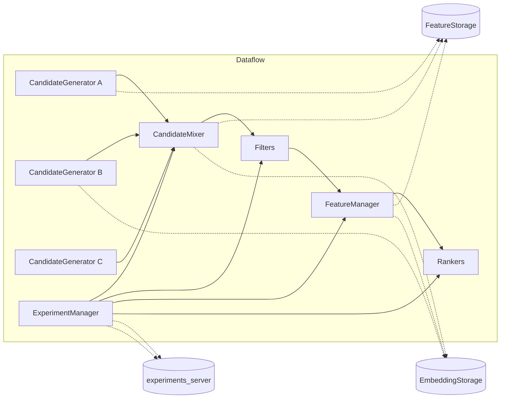

# engine
A framework for building and serving a recommender system: somewhat toy-like, not the most efficient, single-threaded and, on top of that, in Python :-)

## Description

The main entity in this framework is `Recommender`, a protocol that can recommend a set of `Candidate` items for a given `RecContext` context, which contains the user identifier, the time and any other useful information. Several typical components are provided for implementing such protocols:
- `CandidateGenerator`: creates a list of suitable candidates for the request from the context
- `CandidateMixer`: mixes and deduplicates several candidate lists into one list
- `FeatureManager`: enriches the context or the candidates with features from the storages
- `Ranker`: reranks the incoming candidates: by a factor, with random sampling, and so on.
- `Filter`: filters the incoming candidates by an arbitrary condition, for example whether the item identifier is in the Bloom filter from the context or whether the item is in the user's recent history.

There are also several auxiliary protocols that let the recommender get information from other systems or files while processing a request:
- `ExperimentManager`: gets, from the context, the parameters for building the feed for the given user, for example the list of candidate generators or the number of candidates for each of them, the sampling temperature, and so on.
- `EmbeddingStorage`: performs operations on user or item embeddings by their identifier: approximate or exact search, getting embeddings or computing distances between items and a user / an anchor item.
- `FeatureStorage`: gets the features of a user or an item by its identifier from a key-value storage, for example computed statistics, embeddings, lists (the user's history, favourite categories) and more.

For all the protocols above, one or more implementations with different algorithms are provided, together with tests for them. The framework also describes one implementation of the recommender.

### Recommendation engine
The framework also describes one implementation of the `Recommender` protocol: `RecommenderEngine`.

It calls several candidate generators in sequence through the mixer, deduplicates, applies filters, enriches the candidates with features and reranks them. Which components are used and which parameters are chosen for them is configured through a yaml file and, optionally, `ExperimentManager`, which calls the external `experiments_server` service.




## Project structure
```
engine/
├── README.md
├── pyproject.toml
├── src/engine/
│   ├── cg
│   │   ├── __init__.py          # CANDGENS registry
│   │   ├── top_pop.py
│   │   ├── history.py
│   │   ├── item_to_item_lists.py
│   │   ├── slim.py
│   │   ├── user_to_item_knn.py
│   │   ├── item_to_item_knn.py
│   │   └── mixing.py            # mixers and CGSchema
│   ├── ranking
│   │   ├── feature_ranker.py
│   │   └── model_ranker.py
│   ├── features
│   │   ├── config.py
│   │   ├── feature.py
│   │   ├── transform.py
│   │   └── manager.py
│   ├── runtime_profile
│   │   └── runtime_ials.py
│   ├── storages
│   │   ├── hash_key.py
│   │   ├── feature_storage.py
│   │   └── embedding_storage.py
│   ├── interfaces.py
│   ├── recommender.py
│   ├── candidate_logger.py
│   ├── filters.py
│   ├── parameters.py
│   ├── score_model.py
│   ├── bloom.py
│   └── utils.py
├── tests/
```

### interfaces
- The base types `Embedding`, `ID` and `Factor` for type annotations.
- The data structures `RecContext` and `Candidate`, which are the main element.
- The protocols of the various components.
- `ComponentConfig`, the base of the typed component configs (pydantic, unknown keys forbidden), and `ComponentDeps`, the shared dependencies: the storages, the snapshot's `EngineData` and the `CandidateLogger`.

### recommender
The implementation of the configurable recommender and the full request processing logic, from building the context to the final list of candidates.

Each component in the yaml config is described as a `type` (a key in a registry: `CANDGENS`, `CANDGEN_MIXERS`, `RANKERS`, `FEATURE_MANAGERS`, `RUNTIME_PROFILES`) and `parameters`. `RecommenderEngine.startup` builds `ComponentDeps` once, validates `parameters` with the component class's `config_model` and calls `start_component(config, deps)`.

### cg
- Implementations of candidate generators: ANN, SLIM, the user's history, etc., one file per generator; the `CANDGENS` registry is in `cg/__init__.py`.
- Implementations of candidate mixers and the parameterization of the generation stage (how many candidates, from where, in what order).

### ranking
Implementations of reranking components: by a factor, ML models, diversity and sampling.

### feature
- The feature configuration, which describes the dependencies between features (values from the storage -> feature -> feature transformation).
- The logic for computing features and transformations.
- The feature manager, which enriches the context and the candidates according to a given schema.

### storages
Implementations of a key-value storage based on Valkey and an embedding storage based on Qdrant.

### filters
Implementations of candidate filters: a filter by the user's history, a filter by the context for pagination.

#### parameters
The experiment manager for getting request parameters by context from the external experiments service.

#### bloom
A Bloom filter with support for encoding into a string representation for pagination.

#### utils
Helper functions for working with files and object storage.
